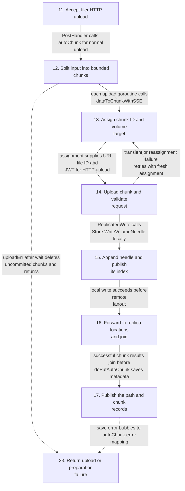
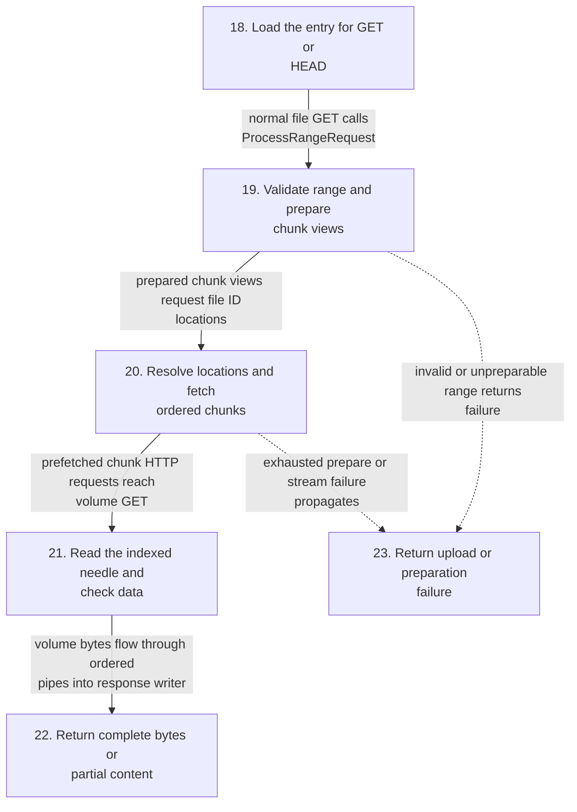
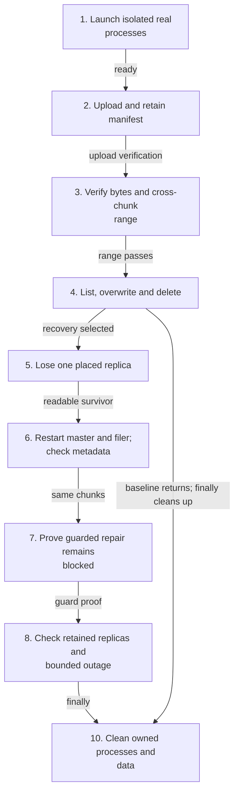
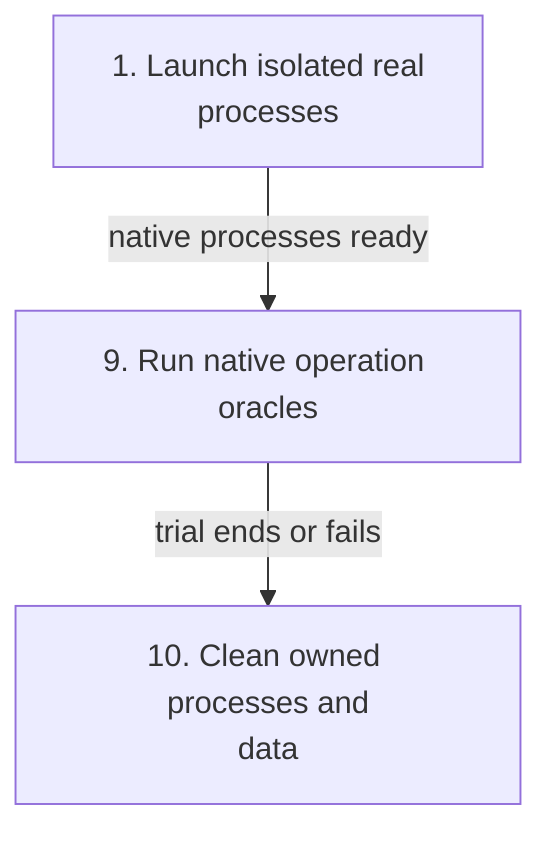
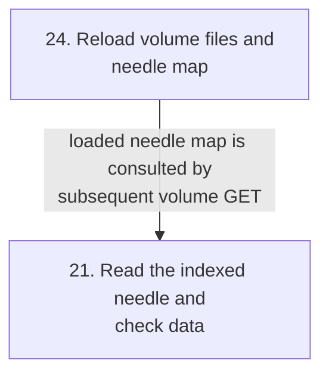
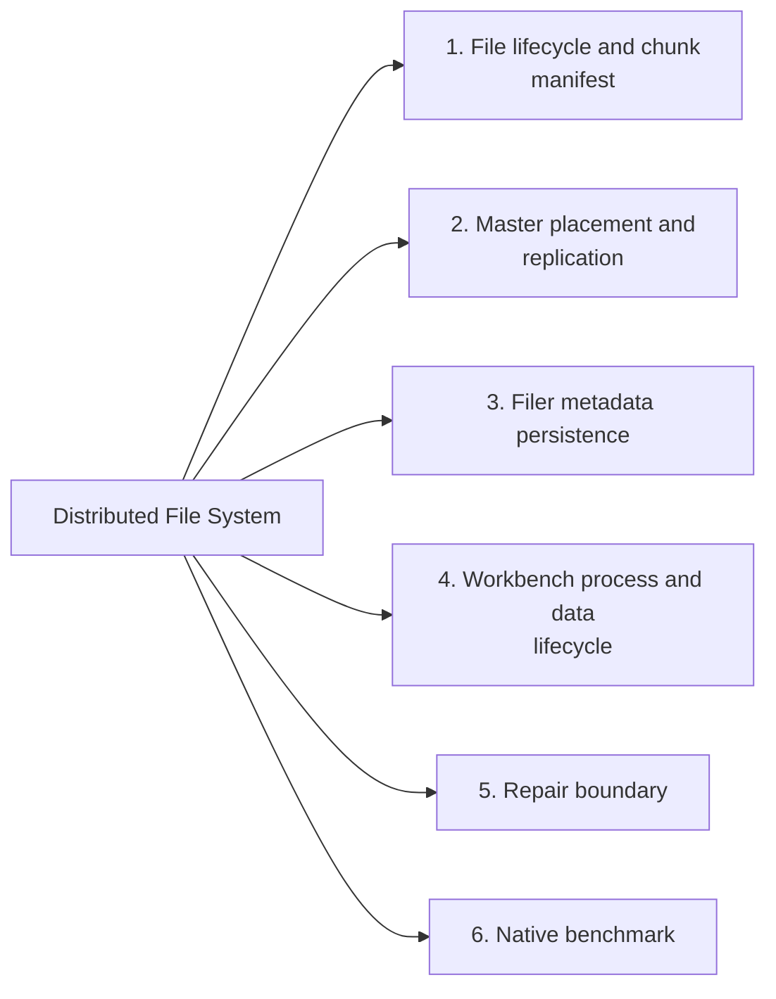
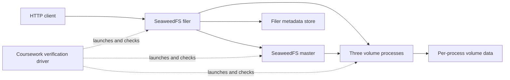
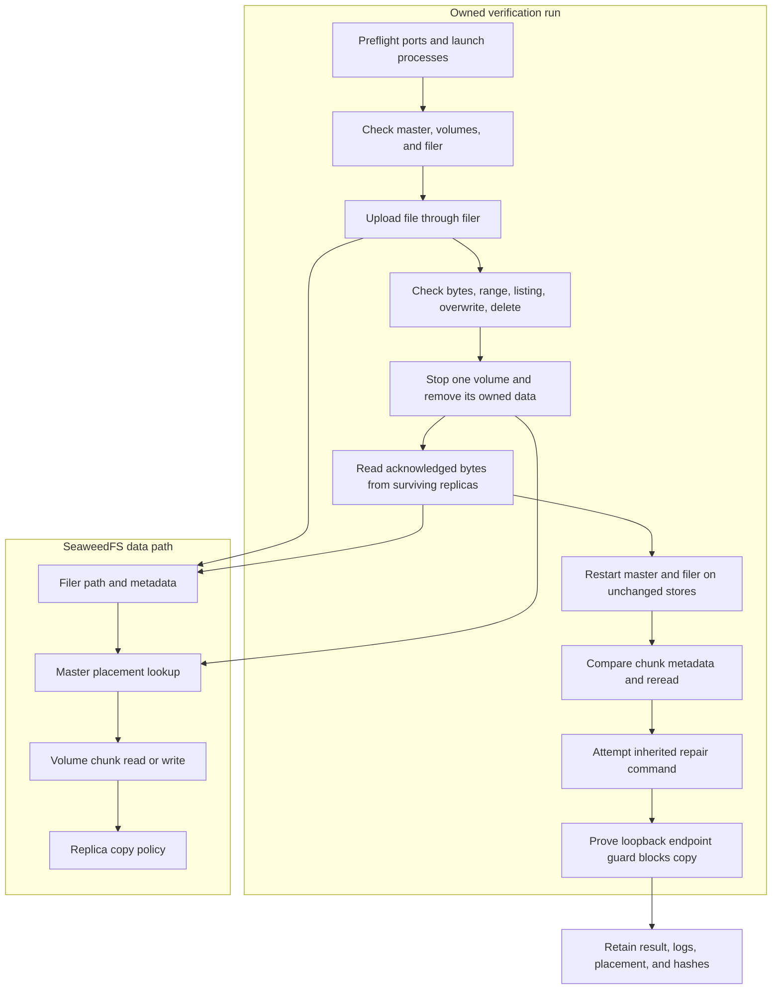

# Distributed File System

## Contents

- [Architecture and execution guide](#architecture-and-execution-guide)
- [Run the experiment](#run-the-experiment)
- [What is proved](#what-is-proved)
- [Repair boundary and research question](#repair-boundary-and-research-question)
- [Implementation techniques](#implementation-techniques)
- [Checks and provenance](#checks-and-provenance)

The [frozen native benchmark](.agents/skills/verify-distributed-file-system/features/benchmark.md) measures the real master/filer/volume HTTP product. `python coursework/benchmark.py smoke` checks exact file bytes, range and deletion. `benchmark` runs five-repeat size/concurrency/operation cells, offered-load/stability and the existing guarded volume-loss/recovery journey on isolated Linux. `profile` captures separate native master/volume CPU profiles. Raw outcomes, latency, byte oracles, placements, storage and CPU/RSS survive under ignored `.local/benchmark-*`. Hosted results and their limits are below. Repair remains explicitly blocked by default replica endpoint policy; filer CPU is unprofiled.

The [completed hosted campaign](coursework/BENCHMARK-EVIDENCE.md) ran 140 trials on Linux at source `3044ff1dbc72cb606eb39f07509ec0dffe1babf7`. All 12,271 offered operations finished with no failures, rejections, timeouts or generator declines. The 27 size, concurrency and operation cells each ran five times. At the highest tested offer rate, 80 transactions/s, a 120-second run completed 9,600 transactions; transaction p99 was 5.689688 ms and dispatch p99 was 0.204087 ms. The run did not reach saturation at 80/s, and these screening thresholds do not define a production SLA. The campaign also measured warm-cache GETs with SHA-256 verification, captured storage after process shutdown, and ran the existing recovery journey. Repair remained blocked by the upstream endpoint guard. See the [full results and limits](coursework/BENCHMARK-EVIDENCE.md).

A fault-recovery coursework workbench built around the full Apache-2.0 [SeaweedFS](https://github.com/seaweedfs/seaweedfs) application. SeaweedFS supplies the master, filer, volume servers, HTTP APIs, replication and persistent metadata. This repository adds a maintained real-process experiment driver, byte-integrity evidence, a verification skill and a focused Windows test-cleanup fix. The original documentation is preserved in [README.upstream.md](README.upstream.md).

Upstream is pinned to [`106fd31af1c866d7ff235ade706cb4a1ba5805ba`](https://github.com/seaweedfs/seaweedfs/commit/106fd31af1c866d7ff235ade706cb4a1ba5805ba), with its complete Git history and license notices. This is an adaptation of an existing application, not an original implementation of SeaweedFS or a claim to have completed Stanford's GoLFS project.

## Architecture and execution guide

<!-- execution-flow:start -->
### Execution flow

Start with the primary path, then expand a detailed workflow. Select a numbered node to see its operation, implementation techniques, and source. Solid arrows show the named control, data, or lifecycle handoff; dotted arrows show error paths. Separate entry points are named in each workflow.

<a id="review-walkthrough"></a>

#### Walk through one concrete example

Upload a multi-chunk ledger.bin through the filer HTTP API, then issue a separate GET for a byte range crossing the 1 MiB boundary.

**Trace.** [Accept filer HTTP upload](#flow-step-http-write) → [Split input into bounded chunks](#flow-step-split) → [Assign chunk ID and volume target](#flow-step-assign) → [Upload chunk and validate request](#flow-step-volume-upload) → [Append needle and publish its index](#flow-step-needle-store) → [Forward to replica locations and join](#flow-step-replicate) → [Publish the path and chunk records](#flow-step-metadata-store).

**Result and boundary.** The filer acknowledges after chunk uploads and metadata creation succeed. A subsequent HTTP GET enters product-read, loads the stored chunk records, clips views to the requested range, discovers volume URLs and streams indexed needle bytes as 206. Verification separately compares those bytes to an independent expected slice. Restart evidence covers retained process stores; repair remains blocked and power-loss durability is not established.

The client then makes a separate HTTP GET with the boundary-crossing Range header; upload does not trigger this request.

**Follow-up trace.** [Load the entry for GET or HEAD](#flow-step-http-read) → [Validate range and prepare chunk views](#flow-step-range-plan) → [Resolve locations and fetch ordered chunks](#flow-step-chunk-fetch) → [Read the indexed needle and check data](#flow-step-needle-read) → [Return complete bytes or partial content](#flow-step-http-result).

The filer clips chunk views to the requested range, resolves volume locations, and streams the volume bytes through ordered pipes to the response. Whole-needle CRC checks do not establish checksum validation for every arbitrary partial range.

<details>
<summary>Implementation decisions to explain</summary>

**Why separate volume chunk writes from publishing the path metadata?** The filer records volume IDs and offsets only after chunk uploads complete, then persists the entry. This separates byte storage from namespace lookup and permits cleanup of uncommitted chunks on upload, digest or metadata failure. It also leaves distinct volume and filer-store failure boundaries; an upload response is not proof of power-loss durability.

[Chunk manifests map paths to volume chunks](#technique-chunk-manifest-addressing) · [Validate persisted filer metadata across restart](#technique-metadata-restart-validation).

**Why discover chunk locations for a range rather than store one server URL in the file entry?** The entry names chunk file IDs and byte intervals. Reads clip those intervals and resolve current volume locations, so the same file can remain readable from a surviving replica after a location disappears. Discovery retries do not create replacement copies. The experiment checks survivor bytes and unchanged metadata, while its guarded repair attempt proves no successful re-replication.

[Resolve chunk placement through master lookup](#technique-master-placement-lookup) · [Translate byte ranges into chunk reads](#technique-range-to-chunk-reads) · [Exercise inherited two-copy replication with controlled loss](#technique-replica-loss-and-restart).

</details>

#### Primary execution flow

Active filer HTTP PUT or multipart POST path. Inherited SeaweedFS product execution, independent of the Python verification driver. Chunk uploads run concurrently; metadata publication joins them. The separate HTTP read workflow shows full GET and byte-range responses.



**Detailed workflows.** [HTTP upload through chunk storage and metadata](#flow-workflow-product-upload) · [HTTP GET and byte ranges through volume needles](#flow-workflow-product-read) · [Real-process file and recovery verification](#flow-workflow-verification) · [Native benchmark trial and cleanup](#flow-workflow-native-benchmark) · [Local volume startup and index recovery](#flow-workflow-volume-restart).

<a id="flow-workflow-product-upload"></a>

<details>
<summary>HTTP upload through chunk storage and metadata</summary>

Active filer HTTP PUT or multipart POST path. Inherited SeaweedFS product execution, independent of the Python verification driver. Chunk uploads run concurrently; metadata publication joins them.


</details>

<a id="flow-workflow-product-read"></a>

<details>
<summary>HTTP GET and byte ranges through volume needles</summary>

Independent HTTP GET entry against an existing file. The upload response does not call GET. Metadata-only and HEAD requests return without fetching chunks.



</details>

<a id="flow-workflow-verification"></a>

<details>
<summary>Real-process file and recovery verification</summary>

Entry coursework/verify.py main; recovery is optional and local repair must remain blocked by endpoint guard.



</details>

<a id="flow-workflow-native-benchmark"></a>

<details>
<summary>Native benchmark trial and cleanup</summary>

Independent benchmark entry runs native trials, real operation oracles and separate sampler/process cleanup; it is not dispatched by verification CLI.



</details>

<a id="flow-workflow-volume-restart"></a>

<details>
<summary>Local volume startup and index recovery</summary>

Volume startup loads retained data and index files before subsequent volume GETs. This does not restore a destroyed replica or bypass endpoint policy.



</details>

#### Steps, techniques, and source

These source traces cover the active scope below. They explain implementation behavior; benchmark results and their limits remain in the measurement sections.

<a id="flow-step-workbench"></a>

##### 1. Launch isolated real processes

**Component.** coursework.verify.Workbench. Validates run name and port range, creates fresh run/data directories and owns process handles. Starts loopback master, three volumes, then filer, probing readiness.

**Techniques at this step.** [Own process handles and constrain destructive cleanup](#technique-owned-process-lifecycle).

**Source.** [`coursework/verify.py:19`](https://github.com/STEVVVU/distributed-file-system/blob/master/coursework/verify.py#L19) · [`coursework/verify.py:119`](https://github.com/STEVVVU/distributed-file-system/blob/master/coursework/verify.py#L119). [Back to execution flow](#execution-flow).

<a id="flow-step-upload"></a>

##### 2. Upload and retain manifest

**Component.** Workbench.drive and filer chunks. Builds a segmented payload and SHA-256 ledger, uploads it, fetches metadata and requires multiple chunks. ViewFromChunks derives visible intervals from chunk metadata.

**Techniques at this step.** [Chunk manifests map paths to volume chunks](#technique-chunk-manifest-addressing).

**Source.** [`coursework/verify.py:149`](https://github.com/STEVVVU/distributed-file-system/blob/master/coursework/verify.py#L149) · [`weed/filer/filechunks.go:209`](https://github.com/STEVVVU/distributed-file-system/blob/master/weed/filer/filechunks.go#L209). [Back to execution flow](#execution-flow).

<a id="flow-step-byte-range"></a>

##### 3. Verify bytes and cross-chunk range

**Component.** Workbench.verify_bytes and ProcessRangeRequest. Verification streams full reads through SHA-256 and checks byte count. It requests a range crossing the 1 MiB boundary and requires status 206 plus the exact expected slice. The active HTTP product path uses visible chunk views and prefetched streaming; ChunkGroup is an inherited separate reader implementation, not the HTTP handler call chain.

**Techniques at this step.** [Stream reads through a SHA-256 byte oracle](#technique-streaming-bytehash-oracle) · [Translate byte ranges into chunk reads](#technique-range-to-chunk-reads).

**Source.** [`coursework/verify.py:139`](https://github.com/STEVVVU/distributed-file-system/blob/master/coursework/verify.py#L139) · [`coursework/verify.py:165`](https://github.com/STEVVVU/distributed-file-system/blob/master/coursework/verify.py#L165) · [`weed/server/common.go:305`](https://github.com/STEVVVU/distributed-file-system/blob/master/weed/server/common.go#L305) · [`weed/filer/filechunk_group.go:117`](https://github.com/STEVVVU/distributed-file-system/blob/master/weed/filer/filechunk_group.go#L117). [Back to execution flow](#execution-flow).

<a id="flow-step-mutations"></a>

##### 4. List, overwrite and delete

**Component.** Workbench.drive. Checks listing, overwrites a separate file and verifies replacement bytes, then deletes it and requires HTTP 404 on read.

Direct filer API verification with no distinct ledger technique.

**Source.** [`coursework/verify.py:170`](https://github.com/STEVVVU/distributed-file-system/blob/master/coursework/verify.py#L170). [Back to execution flow](#execution-flow).

<a id="flow-step-loss"></a>

##### 5. Lose one placed replica

**Component.** Workbench.recovery and Topology.Lookup. Looks up manifest volume placement and requires two locations, stops one selected volume and removes only its contained run data. Waits for the lost node to disappear from lookup and verifies the acknowledged file from survivors.

**Techniques at this step.** [Resolve chunk placement through master lookup](#technique-master-placement-lookup) · [Exercise inherited two-copy replication with controlled loss](#technique-replica-loss-and-restart).

**Source.** [`coursework/verify.py:186`](https://github.com/STEVVVU/distributed-file-system/blob/master/coursework/verify.py#L186) · [`coursework/verify.py:201`](https://github.com/STEVVVU/distributed-file-system/blob/master/coursework/verify.py#L201) · [`weed/topology/topology.go:429`](https://github.com/STEVVVU/distributed-file-system/blob/master/weed/topology/topology.go#L429). [Back to execution flow](#execution-flow).

<a id="flow-step-restart"></a>

##### 6. Restart master and filer; check metadata

**Component.** Workbench.recovery. Restarts master and filer using unchanged stores, waits for surviving volumes to rejoin, verifies bytes and requires identical chunk metadata.

**Techniques at this step.** [Validate persisted filer metadata across restart](#technique-metadata-restart-validation) · [Exercise inherited two-copy replication with controlled loss](#technique-replica-loss-and-restart).

**Source.** [`coursework/verify.py:101`](https://github.com/STEVVVU/distributed-file-system/blob/master/coursework/verify.py#L101) · [`coursework/verify.py:107`](https://github.com/STEVVVU/distributed-file-system/blob/master/coursework/verify.py#L107) · [`coursework/verify.py:218`](https://github.com/STEVVVU/distributed-file-system/blob/master/coursework/verify.py#L218). [Back to execution flow](#execution-flow).

<a id="flow-step-repair-blocked"></a>

##### 7. Prove guarded repair remains blocked

**Component.** Workbench.recovery. Starts a replacement volume and invokes shell replication repair. Requires loopback rejection text and unchanged degraded placement, and records repair.proved=false; successful repair is not demonstrated.

**Techniques at this step.** [Attempt repair while preserving the endpoint guard](#technique-guarded-repair-attempt).

**Source.** [`coursework/verify.py:232`](https://github.com/STEVVVU/distributed-file-system/blob/master/coursework/verify.py#L232). [Back to execution flow](#execution-flow).

<a id="flow-step-outage"></a>

##### 8. Check retained replicas and bounded outage

**Component.** Workbench.recovery. Restarts retained volumes and rechecks bytes, then stops every volume and makes three-second read/write requests. Transport timeout on write is recorded unknown, never acknowledged.

**Techniques at this step.** [Exercise inherited two-copy replication with controlled loss](#technique-replica-loss-and-restart).

**Source.** [`coursework/verify.py:247`](https://github.com/STEVVVU/distributed-file-system/blob/master/coursework/verify.py#L247). [Back to execution flow](#execution-flow).

<a id="flow-step-benchmark"></a>

##### 9. Run native operation oracles

**Component.** coursework.benchmark.trial and benchmark_support.load. Offers real PUT, GET, lifecycle or metadata/listing operations. GET/readback uses full-byte SHA-256, range requires exact bytes, and load classifies every offer including declines, rejection and timeout.

**Techniques at this step.** [Separate offered load from verified operation outcomes](#technique-controlled-load-and-operation-oracles) · [Stream reads through a SHA-256 byte oracle](#technique-streaming-bytehash-oracle) · [Translate byte ranges into chunk reads](#technique-range-to-chunk-reads).

**Source.** [`coursework/benchmark.py:59`](https://github.com/STEVVVU/distributed-file-system/blob/master/coursework/benchmark.py#L59) · [`coursework/benchmark_support.py:97`](https://github.com/STEVVVU/distributed-file-system/blob/master/coursework/benchmark_support.py#L97). [Back to execution flow](#execution-flow).

<a id="flow-step-cleanup"></a>

##### 10. Clean owned processes and data

**Component.** Workbench.finish and benchmark Run.cleanup. Finally stops owned processes, closes logs, removes only validated fresh run data when processes are reaped, and saves cleanup errors into the verdict. Benchmark sampler cleanup is separate; either cleanup failure fails the trial.

**Techniques at this step.** [Own process handles and constrain destructive cleanup](#technique-owned-process-lifecycle).

**Source.** [`coursework/verify.py:275`](https://github.com/STEVVVU/distributed-file-system/blob/master/coursework/verify.py#L275) · [`coursework/verify.py:87`](https://github.com/STEVVVU/distributed-file-system/blob/master/coursework/verify.py#L87) · [`coursework/benchmark.py:109`](https://github.com/STEVVVU/distributed-file-system/blob/master/coursework/benchmark.py#L109) · [`coursework/benchmark_support.py:82`](https://github.com/STEVVVU/distributed-file-system/blob/master/coursework/benchmark_support.py#L82). [Back to execution flow](#execution-flow).

<a id="flow-step-http-write"></a>

##### 11. Accept filer HTTP upload

**Component.** FilerServer.filerHandler / PostHandler. PUT or multipart POST selects storage options, checks path restrictions, and enters autoChunk. The coursework filer sets maxMB=1 and replication=001. Configured in-flight limits wait before upload. Small inline files and unrelated API modes are outside this multi-chunk journey.

**Techniques at this step.** [Chunk manifests map paths to volume chunks](#technique-chunk-manifest-addressing).

**Source.** [`weed/server/filer_server_handlers.go:86`](https://github.com/STEVVVU/distributed-file-system/blob/master/weed/server/filer_server_handlers.go#L86). [Back to execution flow](#execution-flow).

<a id="flow-step-split"></a>

##### 12. Split input into bounded chunks

**Component.** FilerServer.uploadReaderToChunks. Reads bounded buffers, starts chunk upload goroutines under the buffer limit, and waits for every upload before sorting chunk records by offset. Any upload error deletes uncommitted chunks and returns failure.

**Techniques at this step.** [Chunk manifests map paths to volume chunks](#technique-chunk-manifest-addressing).

**Source.** [`weed/server/filer_server_handlers_write_upload.go:108`](https://github.com/STEVVVU/distributed-file-system/blob/master/weed/server/filer_server_handlers_write_upload.go#L108). [Back to execution flow](#execution-flow).

<a id="flow-step-assign"></a>

##### 13. Assign chunk ID and volume target

**Component.** FilerServer.assignNewFileInfo / MasterServer.Assign. Filer calls master Assign over gRPC. Master validates leader, placement and topology, then PickForWrite chooses a writable volume and file ID. Assignment may request volume growth or fail; filer receives the target URL and optional JWT.

**Techniques at this step.** [Resolve chunk placement through master lookup](#technique-master-placement-lookup).

**Source.** [`weed/server/filer_server_handlers_write.go:57`](https://github.com/STEVVVU/distributed-file-system/blob/master/weed/server/filer_server_handlers_write.go#L57) · [`weed/operation/assign_file_id.go:115`](https://github.com/STEVVVU/distributed-file-system/blob/master/weed/operation/assign_file_id.go#L115) · [`weed/server/master_grpc_server_assign.go:125`](https://github.com/STEVVVU/distributed-file-system/blob/master/weed/server/master_grpc_server_assign.go#L125). [Back to execution flow](#execution-flow).

<a id="flow-step-volume-upload"></a>

##### 14. Upload chunk and validate request

**Component.** FilerServer.dataToChunkWithSSE / VolumeServer.PostHandler. Each chunk obtains an assignment and uploads with a chunk MD5. Transient or reassignment errors retry with a new ID; failed attempts are tracked for deletion. Volume parses the needle, validates the request and calls ReplicatedWrite. The handler returns an error if replication fails.

**Techniques at this step.** [Chunk manifests map paths to volume chunks](#technique-chunk-manifest-addressing).

**Source.** [`weed/server/filer_server_handlers_write_upload.go:272`](https://github.com/STEVVVU/distributed-file-system/blob/master/weed/server/filer_server_handlers_write_upload.go#L272) · [`weed/server/volume_server_handlers_write.go:45`](https://github.com/STEVVVU/distributed-file-system/blob/master/weed/server/volume_server_handlers_write.go#L45). [Back to execution flow](#execution-flow).

<a id="flow-step-needle-store"></a>

##### 15. Append needle and publish its index

**Component.** storage.Volume.writeNeedle2. Store writes the needle into the volume data file, then publishes its ID-to-offset mapping. With fsync requested, sync or batch completion precedes acknowledgment and publication is ordered after data sync. The coursework restart experiment does not establish power-loss durability.

**Techniques at this step.** [Exercise inherited two-copy replication with controlled loss](#technique-replica-loss-and-restart).

**Source.** [`weed/storage/volume_write.go:245`](https://github.com/STEVVVU/distributed-file-system/blob/master/weed/storage/volume_write.go#L245) · [`weed/storage/volume_write.go:320`](https://github.com/STEVVVU/distributed-file-system/blob/master/weed/storage/volume_write.go#L320) · [`weed/storage/volume_write.go:339`](https://github.com/STEVVVU/distributed-file-system/blob/master/weed/storage/volume_write.go#L339) · [`weed/storage/needle/needle_write.go:13`](https://github.com/STEVVVU/distributed-file-system/blob/master/weed/storage/needle/needle_write.go#L13). [Back to execution flow](#execution-flow).

<a id="flow-step-replicate"></a>

##### 16. Forward to replica locations and join

**Component.** topology.ReplicatedWrite. After the local write, DistributedOperation sends HTTP uploads to remote replica locations with type=replicate. Forwarded requests suppress recursive fanout. A remote failure returns an error even if the local needle already exists; successful return allows the volume upload acknowledgment.

**Techniques at this step.** [Exercise inherited two-copy replication with controlled loss](#technique-replica-loss-and-restart).

**Source.** [`weed/topology/store_replicate.go:78`](https://github.com/STEVVVU/distributed-file-system/blob/master/weed/topology/store_replicate.go#L78). [Back to execution flow](#execution-flow).

<a id="flow-step-metadata-store"></a>

##### 17. Publish the path and chunk records

**Component.** FilerServer.saveMetaData / Filer.CreateEntry. After uploads complete and whole-request MD5 validation succeeds, saveMetaData attaches chunk IDs, offsets and sizes to the entry and calls CreateEntry. The configured default leveldb2 store encodes attributes and chunks under the path key. The filer returns 201 only after this call succeeds; bad digest or metadata failure removes uncommitted chunks.

**Techniques at this step.** [Chunk manifests map paths to volume chunks](#technique-chunk-manifest-addressing) · [Validate persisted filer metadata across restart](#technique-metadata-restart-validation).

**Source.** [`weed/server/filer_server_handlers_write_autochunk.go:530`](https://github.com/STEVVVU/distributed-file-system/blob/master/weed/server/filer_server_handlers_write_autochunk.go#L530) · [`weed/filer/filer.go:461`](https://github.com/STEVVVU/distributed-file-system/blob/master/weed/filer/filer.go#L461) · [`weed/filer/leveldb2/leveldb2_store.go:97`](https://github.com/STEVVVU/distributed-file-system/blob/master/weed/filer/leveldb2/leveldb2_store.go#L97). [Back to execution flow](#execution-flow).

<a id="flow-step-http-read"></a>

##### 18. Load the entry for GET or HEAD

**Component.** FilerServer.GetOrHeadHandler. FindEntry retrieves path metadata and chunk records. Missing paths return 404 and store failures return 500. Metadata requests return the entry; normal GET checks preconditions and dispatches range handling. HEAD returns headers without streaming chunks.

**Techniques at this step.** [Chunk manifests map paths to volume chunks](#technique-chunk-manifest-addressing) · [Validate persisted filer metadata across restart](#technique-metadata-restart-validation).

**Source.** [`weed/server/filer_server_handlers_read.go:98`](https://github.com/STEVVVU/distributed-file-system/blob/master/weed/server/filer_server_handlers_read.go#L98). [Back to execution flow](#execution-flow).

<a id="flow-step-range-plan"></a>

##### 19. Validate range and prepare chunk views

**Component.** ProcessRangeRequest / PrepareStreamContentWithPrefetch. The HTTP range parser selects the requested offset and length, or the whole file when Range is absent. Invalid ranges return 416. The filer derives visible chunk intervals and clips views to the selected bytes before looking up each chunk location.

**Techniques at this step.** [Translate byte ranges into chunk reads](#technique-range-to-chunk-reads).

**Source.** [`weed/server/filer_server_handlers_read.go:297`](https://github.com/STEVVVU/distributed-file-system/blob/master/weed/server/filer_server_handlers_read.go#L297) · [`weed/server/common.go:346`](https://github.com/STEVVVU/distributed-file-system/blob/master/weed/server/common.go#L346) · [`weed/filer/stream.go:295`](https://github.com/STEVVVU/distributed-file-system/blob/master/weed/filer/stream.go#L295). [Back to execution flow](#execution-flow).

<a id="flow-step-chunk-fetch"></a>

##### 20. Resolve locations and fetch ordered chunks

**Component.** filer.PrepareStreamContentWithPrefetch / streamChunksPrefetched. LookupFileId resolves each view through the master client volume-location cache, populated by the master KeepConnected stream. Lookup uses bounded backoff and context checks. Prefetch fetches volume HTTP chunks concurrently through pipes and consumes views in order; failure before bytes can invalidate stale locations and re-fetch.

**Techniques at this step.** [Resolve chunk placement through master lookup](#technique-master-placement-lookup) · [Translate byte ranges into chunk reads](#technique-range-to-chunk-reads).

**Source.** [`weed/filer/stream.go:310`](https://github.com/STEVVVU/distributed-file-system/blob/master/weed/filer/stream.go#L310) · [`weed/filer/stream_prefetch.go:105`](https://github.com/STEVVVU/distributed-file-system/blob/master/weed/filer/stream_prefetch.go#L105) · [`weed/filer/stream_prefetch.go:177`](https://github.com/STEVVVU/distributed-file-system/blob/master/weed/filer/stream_prefetch.go#L177) · [`weed/wdclient/vid_map.go:144`](https://github.com/STEVVVU/distributed-file-system/blob/master/weed/wdclient/vid_map.go#L144) · [`weed/wdclient/masterclient.go:377`](https://github.com/STEVVVU/distributed-file-system/blob/master/weed/wdclient/masterclient.go#L377) · [`weed/filer/filechunk_manifest.go:438`](https://github.com/STEVVVU/distributed-file-system/blob/master/weed/filer/filechunk_manifest.go#L438). [Back to execution flow](#execution-flow).

<a id="flow-step-needle-read"></a>

##### 21. Read the indexed needle and check data

**Component.** VolumeServer.GetOrHeadHandler / storage.Volume.readNeedle. The volume GET resolves the needle ID through its map and reads the corresponding data-file offset. Full data reads verify the needle CRC. Large streaming reads use the paged path; its CRC check applies to full reads, not arbitrary partial ranges. Missing, deleted or corrupt records fail the read.

**Techniques at this step.** [Translate byte ranges into chunk reads](#technique-range-to-chunk-reads).

**Source.** [`weed/storage/volume_read.go:34`](https://github.com/STEVVVU/distributed-file-system/blob/master/weed/storage/volume_read.go#L34) · [`weed/server/volume_server_handlers_read.go:194`](https://github.com/STEVVVU/distributed-file-system/blob/master/weed/server/volume_server_handlers_read.go#L194) · [`weed/storage/needle/needle_read_tail.go:11`](https://github.com/STEVVVU/distributed-file-system/blob/master/weed/storage/needle/needle_read_tail.go#L11) · [`weed/storage/volume_read.go:263`](https://github.com/STEVVVU/distributed-file-system/blob/master/weed/storage/volume_read.go#L263). [Back to execution flow](#execution-flow).

<a id="flow-step-http-result"></a>

##### 22. Return complete bytes or partial content

**Component.** ProcessRangeRequest. Streams prepared chunks to the HTTP response. A single valid Range returns 206 and Content-Range; a full GET returns the complete length. Stream errors discard buffered tails and abort an already-started response so incomplete content cannot appear complete.

**Techniques at this step.** [Translate byte ranges into chunk reads](#technique-range-to-chunk-reads).

**Source.** [`weed/server/common.go:385`](https://github.com/STEVVVU/distributed-file-system/blob/master/weed/server/common.go#L385). [Back to execution flow](#execution-flow).

<a id="flow-step-http-error"></a>

##### 23. Return upload or preparation failure

**Component.** FilerServer.autoChunk / ProcessRangeRequest. Upload failures map to the implemented HTTP error status, including 400 for bad digest and 500 for other upload or persistence errors. Range preparation errors return before content starts; failures after headers may terminate the response.

**Techniques at this step.** [Chunk manifests map paths to volume chunks](#technique-chunk-manifest-addressing) · [Translate byte ranges into chunk reads](#technique-range-to-chunk-reads).

**Source.** [`weed/server/filer_server_handlers_write_autochunk.go:49`](https://github.com/STEVVVU/distributed-file-system/blob/master/weed/server/filer_server_handlers_write_autochunk.go#L49). [Back to execution flow](#execution-flow).

<a id="flow-step-volume-load"></a>

##### 24. Reload volume files and needle map

**Component.** storage.Volume.load. On volume startup, opens data and index files, rebuilds a missing local index when possible, checks local data integrity, and loads the needle map. Failed integrity or an index pointing beyond the data file makes the volume read-only. This local recovery is distinct from copying a lost replica.

**Techniques at this step.** [Exercise inherited two-copy replication with controlled loss](#technique-replica-loss-and-restart).

**Source.** [`weed/storage/volume_loading.go:257`](https://github.com/STEVVVU/distributed-file-system/blob/master/weed/storage/volume_loading.go#L257). [Back to execution flow](#execution-flow).

<details>
<summary>Scope and subsystem coverage</summary>

Active filer HTTP multi-chunk upload, master assignment, replicated volume needle storage, filer metadata persistence, HTTP GET/range reads and local volume reload directly used by coursework. Verification, controlled loss/restart and guarded repair, and native benchmark remain separate workflows.

- **File lifecycle and chunk manifest.** Upload, manifest, streaming full read, range, listing, overwrite and delete. [Step 2](#flow-step-upload), [Step 3](#flow-step-byte-range), [Step 4](#flow-step-mutations), [Step 11](#flow-step-http-write), [Step 12](#flow-step-split), [Step 14](#flow-step-volume-upload), [Step 17](#flow-step-metadata-store), [Step 18](#flow-step-http-read), [Step 19](#flow-step-range-plan), [Step 20](#flow-step-chunk-fetch), [Step 21](#flow-step-needle-read), [Step 22](#flow-step-http-result), [Step 23](#flow-step-http-error).
- **Master placement and replication.** Lookup snapshots, controlled loss, survivor reads and restarts. [Step 5](#flow-step-loss), [Step 6](#flow-step-restart), [Step 8](#flow-step-outage), [Step 13](#flow-step-assign), [Step 16](#flow-step-replicate), [Step 15](#flow-step-needle-store), [Step 24](#flow-step-volume-load), [Step 20](#flow-step-chunk-fetch).
- **Filer metadata persistence.** Requires chunk metadata equality across restart. [Step 6](#flow-step-restart), [Step 17](#flow-step-metadata-store), [Step 18](#flow-step-http-read).
- **Workbench process and data lifecycle.** Owns processes and fresh run data; cleanup affects verdict. [Step 1](#flow-step-workbench), [Step 10](#flow-step-cleanup).
- **Repair boundary.** Loopback rejection and unchanged degraded placement are required; no successful repair claim. [Step 7](#flow-step-repair-blocked).
- **Native benchmark.** Native offered operations, exact byte/range oracles and cleanup. [Step 9](#flow-step-benchmark), [Step 10](#flow-step-cleanup).

Outside this flow audit:

- `weed/`. Unrelated upstream features, inactive commands, optional backends and deployment tooling are not exercised by these workflows.
- `coursework/benchmark-full-39739708895.json`. Stored campaign outcome evidence, not an execution path.

</details>

<!-- execution-flow:end -->

<details>
<summary>Subsystem technique index</summary>

### Subsystem map

Select a subsystem in the diagram to open its techniques, tradeoffs, and code references. The numbered links provide the same navigation. This map groups components; the execution diagrams show their runtime flow.



1. [File lifecycle and chunk manifest](#subsystem-file-lifecycle-and-chunk-manifest)
2. [Master placement and replication](#subsystem-master-placement-and-replication)
3. [Filer metadata persistence](#subsystem-filer-metadata-persistence)
4. [Workbench process and data lifecycle](#subsystem-workbench-process-and-data-lifecycle)
5. [Repair boundary](#subsystem-repair-boundary)
6. [Native benchmark](#subsystem-native-benchmark)

The complete upstream SeaweedFS application supplies the master, filer, volume servers, HTTP APIs, replication, and metadata persistence. The added coursework scope is a local real-process experiment driver and evidence format. The driver observes normal SeaweedFS APIs and process behavior; it does not add a replacement storage protocol or change replica repair policy.

This boundary map shows the real process roles used by the workbench.

</details>

<details>
<summary>Expand flow diagram 1</summary>



</details>

The filer handles file paths and metadata, then coordinates chunk reads and writes with volume servers. The master tracks volume placement and answers lookup requests. The verification driver starts these inherited processes on loopback and records their actual responses and owned process IDs.

This flow follows the file lifecycle and the constrained recovery journey.

<details>
<summary>Expand flow diagram 2</summary>



</details>

The driver deletes only data beneath the fresh run's `.local/<run>/data` after resolving and checking containment. It verifies file bytes by streaming SHA-256 and records placements before and after loss. Repair remains blocked because the inherited endpoint guard rejects loopback copy targets. A passing run therefore proves reads after one replica loss and process restarts, not restoration of replica count.

| Subsystem | Responsibility | Owned state or invariant | Source |
| --- | --- | --- | --- |
| Master | Track volumes and return chunk placement | Inherited master process and local cluster state | [`weed`](weed) |
| Filer | Serve paths, file metadata, and chunk manifests | Inherited filer store; this journey uses its local LevelDB store | [`weed/filer`](weed/filer) |
| Volume server | Store and serve file chunks | Separate process directory per volume; three processes use replication `001` | [`weed/storage`](weed/storage) |
| Workbench lifecycle | Launch, probe, stop, and clean owned processes | Fresh run directory and retained process handles | [`coursework/verify.py`](coursework/verify.py) |
| Byte and placement oracle | Verify exact bytes and record real placement | SHA-256 byte ledger, manifest, and before/degraded placements | [`coursework/verify.py`](coursework/verify.py) |
| Repair boundary | Record explicit repair attempt and actual guard response | `repair.proved:false` while loopback copy is blocked | [Recovery feature map](.agents/skills/verify-distributed-file-system/features/recovery.md) |

Terms used in the file and recovery paths: [SeaweedFS](#concept-seaweedfs), [master](#concept-master), [filer](#concept-filer), [volume server](#concept-volume), [chunk](#concept-chunk), [replica placement](#concept-replica-placement), [filer metadata](#concept-filer-metadata), and [re-replication](#concept-re-replication).

### Follow one experiment

1. Build `weed.exe` and choose a fresh run name and free six-port range. The driver creates separate data and log paths under `.local/<run>`.
2. The driver starts the master, three volume processes, and a filer. Health probes confirm each process responds before file operations begin.
3. The driver uploads a multi-chunk file through the filer, saves a byte ledger and manifest, then checks a full read, a range crossing a chunk boundary, a listing, an overwrite, and a delete.
4. In the recovery scenario, the driver records actual two-copy placement, stops the process storing one selected replica, and deletes only that process's owned data directory.
5. It waits for placement to become degraded and reads the acknowledged file from surviving copies. It restarts the master and filer using their unchanged stores, then checks the same bytes and chunk metadata.
6. It invokes the inherited repair shell command and checks the server's endpoint rejection and unchanged placement. A timeout or failed assertion leaves `passed:false`; cleanup status and evidence are retained.

### Design decisions and limits

These rationales are inferred from the current implementation. They do not record historic design intent.

| Choice | Practical rationale | Alternative and cost | Reconsider when |
| --- | --- | --- | --- |
| Workbench around full SeaweedFS | Exercises the actual product and retains upstream behavior and provenance | A small mock is easier but cannot prove real chunk and metadata behavior | A separate isolated protocol exercise is needed |
| Use the filer HTTP API | Tests public file lifecycle and chunk mapping through the normal entry point | Direct volume RPC is narrower and skips path metadata behavior | The question targets only volume internals |
| Keep all endpoints on loopback | Makes the local run self-contained and keeps the inherited endpoint guard active | Multi-host endpoints could test actual replica repair but require suitable network and authentication controls | A separately authorized isolated network environment is available |
| Retain evidence outside deleted run data | Allows review after owned process storage is cleaned up | Keeping all stores simplifies forensic inspection but consumes disk and risks stale state reuse | A failure needs a specific retained data directory |
| Treat timed-out writes as unknown | A client deadline cannot establish whether the server committed | Counting a timeout as failure or success can misstate acknowledged data | A protocol-level operation status resolves the outcome |

### Glossary

<a id="concept-seaweedfs"></a>

<details><summary>What is SeaweedFS?</summary>

SeaweedFS is the inherited distributed file and object storage application. This project runs its actual master, filer, and volume binaries; the workbench does not reimplement them.
</details>

<a id="concept-master"></a>

<details><summary>What is the master?</summary>

The master tracks volume servers and maps file chunk identifiers to locations. The driver queries its lookup API to capture placement before and after a volume loss.
</details>

<a id="concept-filer"></a>

<details><summary>What is the filer?</summary>

The filer maps directory paths and metadata to stored chunks and provides the tested HTTP file API. The local journey gives it its own embedded LevelDB store.
</details>

<a id="concept-volume"></a>

<details><summary>What is a volume server?</summary>

A volume server stores chunks and serves them to the filer. The workbench starts three distinct volume processes with separate data directories.
</details>

<a id="concept-chunk"></a>

<details><summary>What is a chunk?</summary>

A chunk is a stored segment of a file. The test uploads more than six MiB with a one MiB chunk size and checks a byte range that crosses a chunk boundary.
</details>

<a id="concept-replica-placement"></a>

<details><summary>What is replica placement?</summary>

Replica placement is the set of volume servers that hold copies of a chunk. The `001` policy used by the journey places two copies on different servers in the same rack.
</details>

<a id="concept-filer-metadata"></a>

<details><summary>What is filer metadata?</summary>

Filer metadata maps paths to entries and their chunk manifests. The recovery check requires the manifest to remain unchanged after the master and filer restart.
</details>

<a id="concept-re-replication"></a>

<details><summary>What is re-replication?</summary>

Re-replication copies data to restore the intended number of copies. This local run cannot prove it because the default volume-copy endpoint guard rejects loopback targets.
</details>

## Implementation techniques

These techniques describe the coursework paths and the inherited SeaweedFS mechanisms they directly exercise; rationale is inferred from current code, not historical design intent.

<details>
<summary>Full technique index</summary>

| Subsystem | Techniques | Sources |
| --- | --- | --- |
| File lifecycle and chunk manifest | [Chunk manifest addressing](#technique-chunk-manifest-addressing), [Range to chunk reads](#technique-range-to-chunk-reads), [Streaming byte hash oracle](#technique-streaming-bytehash-oracle) | [`coursework/verify.py`](coursework/verify.py), [`weed/filer/filechunks.go`](weed/filer/filechunks.go), [`weed/filer/filechunk_group.go`](weed/filer/filechunk_group.go), [`weed/server/common.go`](weed/server/common.go) |
| Master placement and replication | [Master placement lookup](#technique-master-placement-lookup), [Controlled replica loss](#technique-replica-loss-and-restart) | [`coursework/verify.py`](coursework/verify.py), [`weed/topology/topology.go`](weed/topology/topology.go) |
| Filer metadata persistence | [Metadata restart validation](#technique-metadata-restart-validation) | [`coursework/verify.py`](coursework/verify.py) |
| Workbench process and data lifecycle | [Owned process lifecycle](#technique-owned-process-lifecycle) | [`coursework/verify.py`](coursework/verify.py) |
| Repair boundary | [Guarded repair attempt](#technique-guarded-repair-attempt) | [`coursework/verify.py`](coursework/verify.py), [recovery feature](.agents/skills/verify-distributed-file-system/features/recovery.md) |
| Native benchmark | [Controlled load and operation oracles](#technique-controlled-load-and-operation-oracles) | [`coursework/benchmark.py`](coursework/benchmark.py), [`coursework/benchmark_support.py`](coursework/benchmark_support.py), [benchmark feature](.agents/skills/verify-distributed-file-system/features/benchmark.md) |

</details>

<a id="subsystem-file-lifecycle-and-chunk-manifest"></a>

### 1. File lifecycle and chunk manifest

[Back to the subsystem map](#architecture-and-execution-guide).

**Code.** [`coursework/verify.py`](coursework/verify.py), [`weed/filer/filechunk_group.go`](weed/filer/filechunk_group.go), [`weed/filer/filechunks.go`](weed/filer/filechunks.go).

**Techniques.** [Chunk manifests map paths to volume chunks](#technique-chunk-manifest-addressing), [Translate byte ranges into chunk reads](#technique-range-to-chunk-reads), [Stream reads through a SHA-256 byte oracle](#technique-streaming-bytehash-oracle).

**Related concepts.** [SeaweedFS](#concept-seaweedfs), [filer](#concept-filer), [chunk](#concept-chunk).

<a id="technique-chunk-manifest-addressing"></a>

<details>
<summary>Chunk manifests map paths to volume chunks</summary>

**Mechanism.** The filer stores a path entry whose chunk manifest describes the file's byte segments and their volume file IDs. The driver uploads through the filer, fetches `?metadata=true`, and saves the returned manifest. It also records an illustrative 1 MiB segment ledger for its deterministic payload; the ledger is an oracle input, not the server manifest.

**Example.** `/coursework/ledger.bin` resolves to multiple manifest entries, while `byte-ledger.json` records segment offsets and SHA-256 values.

**Why here.** This checks that the normal path API joins metadata to stored chunk data.

**Tradeoffs.** The manifest identifies chunk placement but does not itself prove every stored byte; the separate read oracle does that.

**Code and ownership.** [`Workbench.drive`](coursework/verify.py#L150) is extension code. [`ViewFromChunks`](weed/filer/filechunks.go#L209) is inherited SeaweedFS code.


**Used in.** [File lifecycle and chunk manifest](#subsystem-file-lifecycle-and-chunk-manifest). [Back to the subsystem map](#architecture-and-execution-guide).

</details>

<a id="technique-range-to-chunk-reads"></a>

<details>
<summary>Translate byte ranges into chunk reads</summary>

**Mechanism.** SeaweedFS parses the HTTP Range header, asks a callback for the requested offset and length, and streams only that section. Filer chunk grouping maps the section onto visible chunk intervals. The coursework requests bytes 1,048,570 through 1,048,590, crossing its configured 1 MiB boundary, and compares the returned slice exactly.

**Example.** `Range: bytes=1048570-1048590` must return status 206 and the corresponding 21 payload bytes.

**Why here.** A boundary-crossing request exercises both HTTP range handling and chunk mapping.

**Tradeoffs.** The test covers one range; it does not establish behavior for every multi-range or malformed request form.

**Code and ownership.** [`ProcessRangeRequest`](weed/server/common.go#L305) and [`readDataAtSequential`](weed/filer/filechunk_group.go#L117) are inherited. [`Workbench.drive`](coursework/verify.py#L165) supplies the check.


**Used in.** [File lifecycle and chunk manifest](#subsystem-file-lifecycle-and-chunk-manifest). [Back to the subsystem map](#architecture-and-execution-guide).

</details>

<a id="technique-streaming-bytehash-oracle"></a>

<details>
<summary>Stream reads through a SHA-256 byte oracle</summary>

**Mechanism.** `verify_bytes` consumes the HTTP response in 64 KiB blocks, updates SHA-256, and counts bytes. It requires both length and digest to match the expected payload. Benchmark GET checks use the same exact-byte idea and record the digest with the result.

**Example.** A read passes only when `size == len(expected)` and the streamed digest equals `sha256(expected)`.

**Why here.** It checks complete file content without treating a successful HTTP status as proof of integrity.

**Tradeoffs.** SHA-256 equality is a practical content oracle, while it does not prove persistence under power loss or hostile tampering of both expected data and receipts.

**Code and ownership.** [`Workbench.verify_bytes`](coursework/verify.py#L140) and [`trial`](coursework/benchmark.py#L79) are coursework extensions.


**Used in.** [File lifecycle and chunk manifest](#subsystem-file-lifecycle-and-chunk-manifest). [Back to the subsystem map](#architecture-and-execution-guide).

</details>

<a id="subsystem-master-placement-and-replication"></a>

### 2. Master placement and replication

[Back to the subsystem map](#architecture-and-execution-guide).

**Code.** [`coursework/verify.py`](coursework/verify.py), [`weed/topology/topology.go`](weed/topology/topology.go).

**Techniques.** [Resolve chunk placement through master lookup](#technique-master-placement-lookup), [Exercise inherited two-copy replication with controlled loss](#technique-replica-loss-and-restart).

**Related concepts.** [SeaweedFS](#concept-seaweedfs), [master](#concept-master), [filer](#concept-filer), [chunk](#concept-chunk).

<a id="technique-master-placement-lookup"></a>

<details>
<summary>Resolve chunk placement through master lookup</summary>

**Mechanism.** For each manifest volume ID, the driver queries the master's `/dir/lookup` endpoint, saves the full responses, and reduces each response to its advertised location URLs. It takes snapshots before loss, while degraded, and after the repair attempt.

**Example.** Each volume ID is queried with `read=yes`; the resulting location set is checked for two servers under replication `001`.

**Why here.** Comparing actual placement makes the fault journey about the live cluster state rather than a configured replica count.

**Tradeoffs.** Lookup reports the master's current view, so it does not alone establish that every listed copy is readable.

**Code and ownership.** [`Workbench.placement`](coursework/verify.py#L186) adds the evidence capture; [`Topology.Lookup`](weed/topology/topology.go#L429) is inherited SeaweedFS topology code.


**Used in.** [Master placement and replication](#subsystem-master-placement-and-replication). [Back to the subsystem map](#architecture-and-execution-guide).

</details>

<a id="technique-replica-loss-and-restart"></a>

<details>
<summary>Exercise inherited two-copy replication with controlled loss</summary>

**Mechanism.** The master and filer use the inherited `001` replication setting. In SeaweedFS this is a two-copy policy; the driver first confirms two locations, then stops one volume process and removes only that process's owned data. It waits for degraded placement, reads the acknowledged file, restarts master and filer against their same stores, and reads again.

**Example.** A successful recovery read has matching size and SHA-256 after loss and after the master/filer restart.

**Why here.** This tests availability of acknowledged bytes through one controlled replica failure and metadata service restart.

**Tradeoffs.** Same-host process restart is not power-loss durability; degraded reads do not show replica restoration. No GFS primary lease or atomic append behavior is claimed.

**Code and ownership.** [`Workbench.start_master`](coursework/verify.py#L93) configures inherited behavior; [`Workbench.recovery`](coursework/verify.py#L201) implements the coursework journey.


**Used in.** [Master placement and replication](#subsystem-master-placement-and-replication). [Back to the subsystem map](#architecture-and-execution-guide).

</details>

<a id="subsystem-filer-metadata-persistence"></a>

### 3. Filer metadata persistence

[Back to the subsystem map](#architecture-and-execution-guide).

**Code.** [`coursework/verify.py`](coursework/verify.py).

**Techniques.** [Validate persisted filer metadata across restart](#technique-metadata-restart-validation).

**Related concepts.** [master](#concept-master), [filer](#concept-filer), [chunk](#concept-chunk), [filer metadata](#concept-filer-metadata).

<a id="technique-metadata-restart-validation"></a>

<details>
<summary>Validate persisted filer metadata across restart</summary>

**Mechanism.** The local filer writes metadata to its own configured store directory. After the master and filer stop, the driver starts them again in their existing process directories, waits for volumes to rejoin, fetches metadata for the same path, and requires its chunk list to equal the pre-restart list.

**Example.** `restarted["chunks"] == chunks` must hold before recording `persistent-metadata`.

**Why here.** This couples a byte reread with a structural check that the path still points to the same chunk manifest.

**Tradeoffs.** It verifies process restart with unchanged local stores, not store corruption, host loss, or fsync guarantees.

**Code and ownership.** [`Workbench.start_filer`](coursework/verify.py#L99) and [`Workbench.recovery`](coursework/verify.py#L225) are coursework setup and checks over inherited filer persistence.


**Used in.** [Filer metadata persistence](#subsystem-filer-metadata-persistence). [Back to the subsystem map](#architecture-and-execution-guide).

</details>

<a id="subsystem-workbench-process-and-data-lifecycle"></a>

### 4. Workbench process and data lifecycle

[Back to the subsystem map](#architecture-and-execution-guide).

**Code.** [`coursework/verify.py`](coursework/verify.py).

**Techniques.** [Own process handles and constrain destructive cleanup](#technique-owned-process-lifecycle).

<a id="technique-owned-process-lifecycle"></a>

<details>
<summary>Own process handles and constrain destructive cleanup</summary>

**Mechanism.** The driver retains each subprocess handle and log, terminates and reaps owned processes during cleanup, then resolves the deletion target and checks it remains inside the fresh run's data directory before recursive removal. Cleanup failures are retained in the result rather than hidden.

**Example.** Removing the lost replica calls `remove_data` only after stopping that volume; the method rejects targets outside `.local/<run>/data`.

**Why here.** Repeated fault runs need isolated process and storage ownership, with evidence left outside the deleted data tree.

**Tradeoffs.** Cleanup can fail and leave owned data behind; the driver reports that failure and marks the run unsuccessful.

**Code and ownership.** [`Workbench.start`](coursework/verify.py#L69), [`Workbench.remove_data`](coursework/verify.py#L85), and [`Workbench.cleanup`](coursework/verify.py#L277) are coursework extensions.


**Used in.** [Workbench process and data lifecycle](#subsystem-workbench-process-and-data-lifecycle). [Back to the subsystem map](#architecture-and-execution-guide).

</details>

<a id="subsystem-repair-boundary"></a>

### 5. Repair boundary

[Back to the subsystem map](#architecture-and-execution-guide).

**Code.** [`coursework/verify.py`](coursework/verify.py).

**Techniques.** [Attempt repair while preserving the endpoint guard](#technique-guarded-repair-attempt).

**Related concepts.** [re-replication](#concept-re-replication).

<a id="technique-guarded-repair-attempt"></a>

<details>
<summary>Attempt repair while preserving the endpoint guard</summary>

**Mechanism.** The recovery journey invokes the inherited `volume.fix.replication` shell command with apply enabled and zero retries, saves its output, checks for the loopback endpoint rejection, then takes another placement snapshot and requires it to remain unchanged. The result records `repair.proved:false`.

**Example.** An exit code of zero is insufficient: the server's rejection text and unchanged degraded placement are both required.

**Why here.** This makes the repair boundary observable without disabling the inherited endpoint safety policy.

**Tradeoffs.** The journey proves that local loopback repair is blocked. It does not prove re-replication or survival after another loss.

**Code and ownership.** [`Workbench.recovery`](coursework/verify.py#L232) and [`Workbench.snapshot`](coursework/verify.py#L196) are coursework checks around inherited repair behavior.


**Used in.** [Repair boundary](#subsystem-repair-boundary). [Back to the subsystem map](#architecture-and-execution-guide).

</details>

<a id="subsystem-native-benchmark"></a>

### 6. Native benchmark

[Back to the subsystem map](#architecture-and-execution-guide).

**Code.** [`coursework/benchmark.py`](coursework/benchmark.py), [`coursework/benchmark_support.py`](coursework/benchmark_support.py), [`.agents/skills/verify-distributed-file-system/features/benchmark.md`](.agents/skills/verify-distributed-file-system/features/benchmark.md).

**Techniques.** [Separate offered load from verified operation outcomes](#technique-controlled-load-and-operation-oracles).

<a id="technique-controlled-load-and-operation-oracles"></a>

<details>
<summary>Separate offered load from verified operation outcomes</summary>

**Mechanism.** The native benchmark fixes workload inputs, launches isolated real processes per trial, and records transaction offers, completion outcomes, and per-operation oracles. PUT readback checks bytes outside the timed response; GET timing includes full-byte digest validation; metadata timing covers stat plus listing. The recovery cell reuses the guarded fault journey.

**Example.** Each measured cell retains trial results and payload digests; smoke mode checks lifecycle and range bytes without presenting timings as performance results.

**Why here.** Separating timing scopes from content checks makes each recorded operation's evidence explicit.

**Tradeoffs.** Warm-cache reads and screening thresholds describe this workload only; they are not production guarantees.

**Code and ownership.** [`trial`](coursework/benchmark.py#L59), [`main`](coursework/benchmark.py#L132), and [`load`](coursework/benchmark_support.py#L97) are coursework extensions.


**Used in.** [Native benchmark](#subsystem-native-benchmark). [Back to the subsystem map](#architecture-and-execution-guide).

</details>

## Run the experiment

Requirements: Go 1.26.6 or newer, Python 3.11 or newer, and six free loopback HTTP ports plus their gRPC counterparts. Tested locally on Windows amd64 with Go 1.27.3, Python 3.11, and CGO disabled. No Docker, FUSE driver, cloud account or API keys are needed.

```powershell
$env:CGO_ENABLED='0'
$env:GOTOOLCHAIN='local'
go build -o .local/weed.exe ./weed
python coursework/verify.py --run recovery
```

Use a new `--run` name for each invocation. The default ports are HTTP 19370–19375 and gRPC 29370–29375; use `--port 19400` to choose another range. Sequential journeys should use distinct ranges: a released Linux socket can remain unavailable to the preflight bind while it is in TIME_WAIT. The driver owns only its fresh `.local/<run>/data` directory and subprocess handles. It removes that data and stops its processes in `finally`; evidence remains under `.local/<run>/`. Do not use Python's `-O` option: the driver uses assertions as verification oracles.

For just the file lifecycle, run `python coursework/verify.py --run files --scenario baseline`. To check failure handling, run `python coursework/verify.py --run intentional-failure --port 19400 --fail`: exit 1, `passed:false`, and `cleanup:true` are expected.

## What is proved

The driver starts a master, one filer with its own embedded LevelDB store, and three distinct volume processes using replication `001` (two copies on different servers in the same rack). It uploads a 6,291,473-byte file with different contents in each 1 MiB segment, retains the actual seven-chunk manifest and segment SHA-256 ledger, streams the downloaded bytes through SHA-256, reads a range crossing a chunk boundary, lists the file, overwrites a separate file, and deletes it.

The recovery journey erases one stopped replica's actual data, proves the acknowledged file remains readable, restarts the master and filer against their unchanged stores, requires unchanged chunk metadata, and restarts the surviving volume processes before checking the same file again. After all volume processes stop, it records bounded unavailable reads and writes. A write whose client deadline expires is **unknown**, never counted as acknowledged.

The retained local run on October 21, 2026 (`.local/reviewed-proof/result.json`) passed these checks and cleanup. All four full-file reads matched SHA-256 `2edcea6cb0b3a9ed03bb31b09c01cb53b9569b7603a6bff2170e07193dfc9b13`. The final unavailable read returned HTTP 500; the unavailable write reached its three-second client deadline and was recorded as unknown. See [results and commands](coursework/RESULTS.md) and the [verification skill](.agents/skills/verify-distributed-file-system/SKILL.md) for reproducible checks.

## Repair boundary and research question

The experiment asks how a GFS-style system preserves acknowledged bytes after replica failure and how an operator restores replica count. SeaweedFS's [official replication documentation](https://github.com/seaweedfs/seaweedfs/wiki/Replication) describes volume replication and explicit `volume.fix.replication` repair. Its semantics differ from GFS primary leases and atomic record append; this workbench makes no claim to implement those GFS contracts.

The driver starts an empty replacement volume and invokes the inherited shell's `volume.fix.replication -apply -retry=0`. At the pinned revision, the default replica endpoint guard rejects loopback source addresses. The shell can still exit zero, so the driver checks the actual rejection and unchanged degraded placement, retaining `repair.log` and `repair.proved:false`. A passing workbench run therefore **does not prove re-replication or survival after another replica loss**.

The guard remains enabled. Successful copy requires a separately authorized, suitably isolated multi-host/private-network experiment with appropriate authentication and endpoint policy. The inherited `-volume.allowUntrustedRemoteEndpoints` flag broadly disables endpoint checks; the driver does not use it. See the [recovery feature map](.agents/skills/verify-distributed-file-system/features/recovery.md).

One local filer store and one master remain availability bottlenecks. Process restarts and same-host copies do not prove power-loss, fsync, multi-host durability, POSIX/FUSE correctness or production readiness. The [GoLFS paper](https://www.scs.stanford.edu/24sp-cs244b/projects/GoLFS_A_Fault-tolerant_GFS_Implementation.pdf) supplies research context only; no unlicensed student source was copied.

## Checks and provenance

The full upstream default Windows binary builds with `CGO_ENABLED=0`; no source subset, overlay, installers or dependency changes were needed. Feature-tagged backends and native mounts were not exercised. Existing placement, replica-repair shell, server endpoint and copy tests pass after a one-line cleanup fix that closes a test store before Windows removes its temporary directory. [Provenance and audit](coursework/PROVENANCE.md) documents the license, dependency scan, original workflows and limitations.

The sole active [coursework CI](.github/workflows/storage-checks.yml) has read-only contents permission and performs build, static checks and real-process verification. The 74 original workflows remain unchanged as `*.yml.upstream`, which GitHub Actions does not execute. No release uploads, deployment jobs or secret references are active. CI has been authored and locally inspected; a remote Actions run is not claimed.

See [LICENSE](LICENSE) and the original [upstream README](README.upstream.md) for the inherited application's documentation and attribution.
