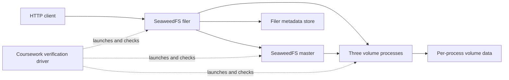
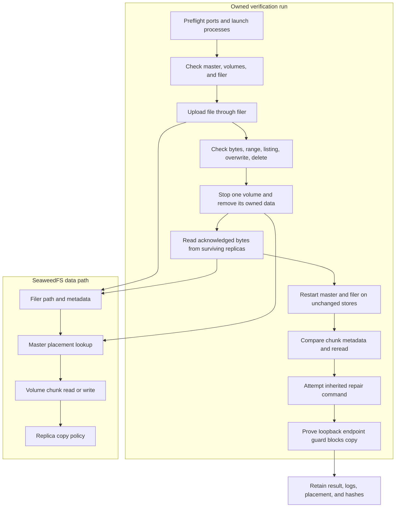

# Distributed File System

## Contents

- [Architecture and execution guide](#architecture-and-execution-guide)
- [Run the experiment](#run-the-experiment)
- [What is proved](#what-is-proved)
- [Repair boundary and research question](#repair-boundary-and-research-question)
- [Checks and provenance](#checks-and-provenance)

The [frozen native benchmark](.agents/skills/verify-distributed-file-system/features/benchmark.md) measures the real master/filer/volume HTTP product. `python coursework/benchmark.py smoke` checks exact file bytes, range and deletion. `benchmark` runs five-repeat size/concurrency/operation cells, offered-load/stability and the existing guarded volume-loss/recovery journey on isolated Linux. `profile` captures separate native master/volume CPU profiles. Raw outcomes, latency, byte oracles, placements, storage and CPU/RSS survive under ignored `.local/benchmark-*`. Hosted results and their limits are below. Repair remains explicitly blocked by default replica endpoint policy; filer CPU is unprofiled.

The [completed hosted campaign](coursework/BENCHMARK-EVIDENCE.md) ran 140 trials on Linux at source `3044ff1dbc72cb606eb39f07509ec0dffe1babf7`. All 12,271 offered operations finished with no failures, rejections, timeouts or generator declines. The 27 size, concurrency and operation cells each ran five times. At the highest tested offer rate, 80 transactions/s, a 120-second run completed 9,600 transactions; transaction p99 was 5.689688 ms and dispatch p99 was 0.204087 ms. The run did not reach saturation at 80/s, and these screening thresholds do not define a production SLA. The campaign also measured warm-cache GETs with SHA-256 verification, captured storage after process shutdown, and ran the existing recovery journey. Repair remained blocked by the upstream endpoint guard. See the [full results and limits](coursework/BENCHMARK-EVIDENCE.md).

A fault-recovery coursework workbench built around the full Apache-2.0 [SeaweedFS](https://github.com/seaweedfs/seaweedfs) application. SeaweedFS supplies the master, filer, volume servers, HTTP APIs, replication and persistent metadata. This repository adds a maintained real-process experiment driver, byte-integrity evidence, a verification skill and a focused Windows test-cleanup fix. The original documentation is preserved in [README.upstream.md](README.upstream.md).

Upstream is pinned to [`106fd31af1c866d7ff235ade706cb4a1ba5805ba`](https://github.com/seaweedfs/seaweedfs/commit/106fd31af1c866d7ff235ade706cb4a1ba5805ba), with its complete Git history and license notices. This is an adaptation of an existing application, not an original implementation of SeaweedFS or a claim to have completed Stanford's GoLFS project.

## Architecture and execution guide

The complete upstream SeaweedFS application supplies the master, filer, volume servers, HTTP APIs, replication, and metadata persistence. The added coursework scope is a local real-process experiment driver and evidence format. The driver observes normal SeaweedFS APIs and process behavior; it does not add a replacement storage protocol or change replica repair policy.

This boundary map shows the real process roles used by the workbench.



The filer handles file paths and metadata, then coordinates chunk reads and writes with volume servers. The master tracks volume placement and answers lookup requests. The verification driver starts these inherited processes on loopback and records their actual responses and owned process IDs.

This flow follows the file lifecycle and the constrained recovery journey.



The driver deletes only data beneath the fresh run's `.local/<run>/data` after resolving and checking containment. It verifies file bytes by streaming SHA-256 and records placements before and after loss. Repair remains blocked because the inherited endpoint guard rejects loopback copy targets. A passing run therefore proves reads after one replica loss and process restarts, not restoration of replica count.

| Subsystem | Responsibility | Owned state or invariant | Source |
| --- | --- | --- | --- |
| Master | Track volumes and return chunk placement | Inherited master process and local cluster state | [`weed`](weed) |
| Filer | Serve paths, file metadata, and chunk manifests | Inherited filer store; this journey uses its local LevelDB store | [`weed/filer`](weed/filer) |
| Volume server | Store and serve file chunks | Separate process directory per volume; three processes use replication `001` | [`weed/storage`](weed/storage) |
| Workbench lifecycle | Launch, probe, stop, and clean owned processes | Fresh run directory and retained process handles | [`coursework/verify.py`](coursework/verify.py) |
| Byte and placement oracle | Verify exact bytes and record real placement | SHA-256 byte ledger, manifest, and before/degraded placements | [`coursework/verify.py`](coursework/verify.py) |
| Repair boundary | Record explicit repair attempt and actual guard response | `repair.proved:false` while loopback copy is blocked | [Recovery feature map](.agents/skills/verify-distributed-file-system/features/recovery.md) |

Terms used in the file and recovery paths: [SeaweedFS](#concept-seaweedfs), [master](#concept-master), [filer](#concept-filer), [volume server](#concept-volume), [chunk](#concept-chunk), [replica placement](#concept-replica-placement), [filer metadata](#concept-filer-metadata), and [re-replication](#concept-re-replication).

### Follow one experiment

1. Build `weed.exe` and choose a fresh run name and free six-port range. The driver creates separate data and log paths under `.local/<run>`.
2. The driver starts the master, three volume processes, and a filer. Health probes confirm each process responds before file operations begin.
3. The driver uploads a multi-chunk file through the filer, saves a byte ledger and manifest, then checks a full read, a range crossing a chunk boundary, a listing, an overwrite, and a delete.
4. In the recovery scenario, the driver records actual two-copy placement, stops the process storing one selected replica, and deletes only that process's owned data directory.
5. It waits for placement to become degraded and reads the acknowledged file from surviving copies. It restarts the master and filer using their unchanged stores, then checks the same bytes and chunk metadata.
6. It invokes the inherited repair shell command and checks the server's endpoint rejection and unchanged placement. A timeout or failed assertion leaves `passed:false`; cleanup status and evidence are retained.

### Design decisions and limits

These rationales are inferred from the current implementation. They do not record historic design intent.

| Choice | Practical rationale | Alternative and cost | Reconsider when |
| --- | --- | --- | --- |
| Workbench around full SeaweedFS | Exercises the actual product and retains upstream behavior and provenance | A small mock is easier but cannot prove real chunk and metadata behavior | A separate isolated protocol exercise is needed |
| Use the filer HTTP API | Tests public file lifecycle and chunk mapping through the normal entry point | Direct volume RPC is narrower and skips path metadata behavior | The question targets only volume internals |
| Keep all endpoints on loopback | Makes the local run self-contained and keeps the inherited endpoint guard active | Multi-host endpoints could test actual replica repair but require suitable network and authentication controls | A separately authorized isolated network environment is available |
| Retain evidence outside deleted run data | Allows review after owned process storage is cleaned up | Keeping all stores simplifies forensic inspection but consumes disk and risks stale state reuse | A failure needs a specific retained data directory |
| Treat timed-out writes as unknown | A client deadline cannot establish whether the server committed | Counting a timeout as failure or success can misstate acknowledged data | A protocol-level operation status resolves the outcome |

### Glossary

<a id="concept-seaweedfs"></a>

<details><summary>What is SeaweedFS?</summary>

SeaweedFS is the inherited distributed file and object storage application. This project runs its actual master, filer, and volume binaries; the workbench does not reimplement them.
</details>

<a id="concept-master"></a>

<details><summary>What is the master?</summary>

The master tracks volume servers and maps file chunk identifiers to locations. The driver queries its lookup API to capture placement before and after a volume loss.
</details>

<a id="concept-filer"></a>

<details><summary>What is the filer?</summary>

The filer maps directory paths and metadata to stored chunks and provides the tested HTTP file API. The local journey gives it its own embedded LevelDB store.
</details>

<a id="concept-volume"></a>

<details><summary>What is a volume server?</summary>

A volume server stores chunks and serves them to the filer. The workbench starts three distinct volume processes with separate data directories.
</details>

<a id="concept-chunk"></a>

<details><summary>What is a chunk?</summary>

A chunk is a stored segment of a file. The test uploads more than six MiB with a one MiB chunk size and checks a byte range that crosses a chunk boundary.
</details>

<a id="concept-replica-placement"></a>

<details><summary>What is replica placement?</summary>

Replica placement is the set of volume servers that hold copies of a chunk. The `001` policy used by the journey places two copies on different servers in the same rack.
</details>

<a id="concept-filer-metadata"></a>

<details><summary>What is filer metadata?</summary>

Filer metadata maps paths to entries and their chunk manifests. The recovery check requires the manifest to remain unchanged after the master and filer restart.
</details>

<a id="concept-re-replication"></a>

<details><summary>What is re-replication?</summary>

Re-replication copies data to restore the intended number of copies. This local run cannot prove it because the default volume-copy endpoint guard rejects loopback targets.
</details>

## Run the experiment

Requirements: Go 1.26.6 or newer, Python 3.11 or newer, and six free loopback HTTP ports plus their gRPC counterparts. Tested locally on Windows amd64 with Go 1.27.3, Python 3.11, and CGO disabled. No Docker, FUSE driver, cloud account or API keys are needed.

```powershell
$env:CGO_ENABLED='0'
$env:GOTOOLCHAIN='local'
go build -o .local/weed.exe ./weed
python coursework/verify.py --run recovery
```

Use a new `--run` name for each invocation. The default ports are HTTP 19370–19375 and gRPC 29370–29375; use `--port 19400` to choose another range. Sequential journeys should use distinct ranges: a released Linux socket can remain unavailable to the preflight bind while it is in TIME_WAIT. The driver owns only its fresh `.local/<run>/data` directory and subprocess handles. It removes that data and stops its processes in `finally`; evidence remains under `.local/<run>/`. Do not use Python's `-O` option: the driver uses assertions as verification oracles.

For just the file lifecycle, run `python coursework/verify.py --run files --scenario baseline`. To check failure handling, run `python coursework/verify.py --run intentional-failure --port 19400 --fail`: exit 1, `passed:false`, and `cleanup:true` are expected.

## What is proved

The driver starts a master, one filer with its own embedded LevelDB store, and three distinct volume processes using replication `001` (two copies on different servers in the same rack). It uploads a 6,291,473-byte file with different contents in each 1 MiB segment, retains the actual seven-chunk manifest and segment SHA-256 ledger, streams the downloaded bytes through SHA-256, reads a range crossing a chunk boundary, lists the file, overwrites a separate file, and deletes it.

The recovery journey erases one stopped replica's actual data, proves the acknowledged file remains readable, restarts the master and filer against their unchanged stores, requires unchanged chunk metadata, and restarts the surviving volume processes before checking the same file again. After all volume processes stop, it records bounded unavailable reads and writes. A write whose client deadline expires is **unknown**, never counted as acknowledged.

The retained local run on October 21, 2026 (`.local/reviewed-proof/result.json`) passed these checks and cleanup. All four full-file reads matched SHA-256 `2edcea6cb0b3a9ed03bb31b09c01cb53b9569b7603a6bff2170e07193dfc9b13`. The final unavailable read returned HTTP 500; the unavailable write reached its three-second client deadline and was recorded as unknown. See [results and commands](coursework/RESULTS.md) and the [verification skill](.agents/skills/verify-distributed-file-system/SKILL.md) for reproducible checks.

## Repair boundary and research question

The experiment asks how a GFS-style system preserves acknowledged bytes after replica failure and how an operator restores replica count. SeaweedFS's [official replication documentation](https://github.com/seaweedfs/seaweedfs/wiki/Replication) describes volume replication and explicit `volume.fix.replication` repair. Its semantics differ from GFS primary leases and atomic record append; this workbench makes no claim to implement those GFS contracts.

The driver starts an empty replacement volume and invokes the inherited shell's `volume.fix.replication -apply -retry=0`. At the pinned revision, the default replica endpoint guard rejects loopback source addresses. The shell can still exit zero, so the driver checks the actual rejection and unchanged degraded placement, retaining `repair.log` and `repair.proved:false`. A passing workbench run therefore **does not prove re-replication or survival after another replica loss**.

The guard remains enabled. Successful copy requires a separately authorized, suitably isolated multi-host/private-network experiment with appropriate authentication and endpoint policy. The inherited `-volume.allowUntrustedRemoteEndpoints` flag broadly disables endpoint checks; the driver does not use it. See the [recovery feature map](.agents/skills/verify-distributed-file-system/features/recovery.md).

One local filer store and one master remain availability bottlenecks. Process restarts and same-host copies do not prove power-loss, fsync, multi-host durability, POSIX/FUSE correctness or production readiness. The [GoLFS paper](https://www.scs.stanford.edu/24sp-cs244b/projects/GoLFS_A_Fault-tolerant_GFS_Implementation.pdf) supplies research context only; no unlicensed student source was copied.

## Checks and provenance

The full upstream default Windows binary builds with `CGO_ENABLED=0`; no source subset, overlay, installers or dependency changes were needed. Feature-tagged backends and native mounts were not exercised. Existing placement, replica-repair shell, server endpoint and copy tests pass after a one-line cleanup fix that closes a test store before Windows removes its temporary directory. [Provenance and audit](coursework/PROVENANCE.md) documents the license, dependency scan, original workflows and limitations.

The sole active [coursework CI](.github/workflows/storage-checks.yml) has read-only contents permission and performs build, static checks and real-process verification. The 74 original workflows remain unchanged as `*.yml.upstream`, which GitHub Actions does not execute. No release uploads, deployment jobs or secret references are active. CI has been authored and locally inspected; a remote Actions run is not claimed.

See [LICENSE](LICENSE) and the original [upstream README](README.upstream.md) for the inherited application's documentation and attribution.
